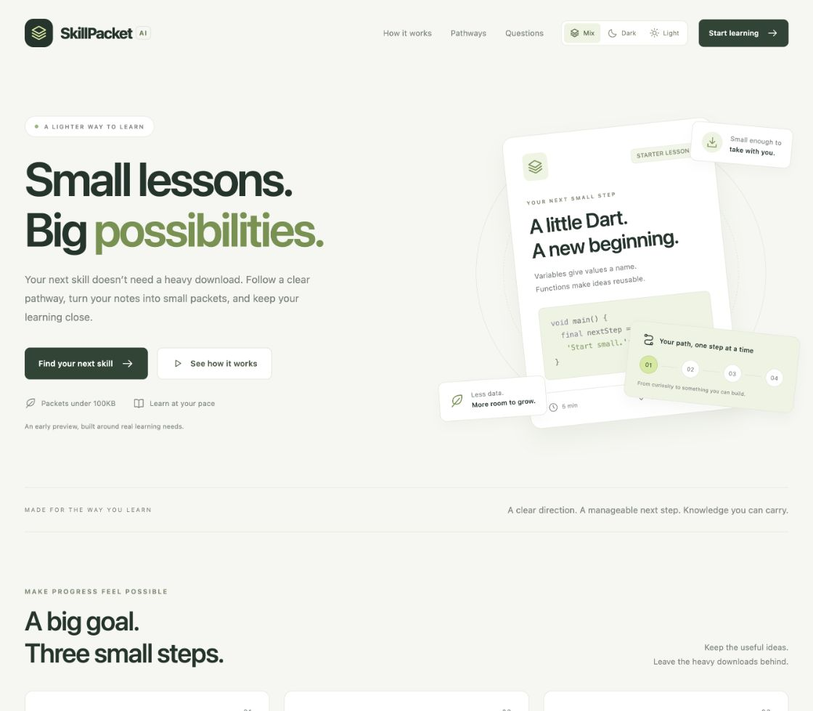
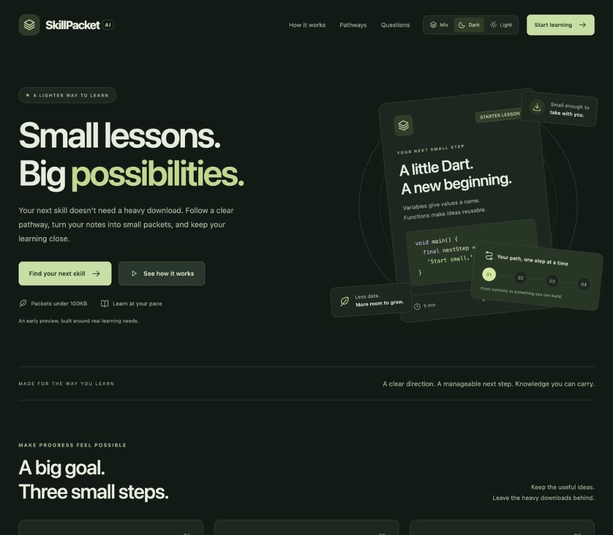
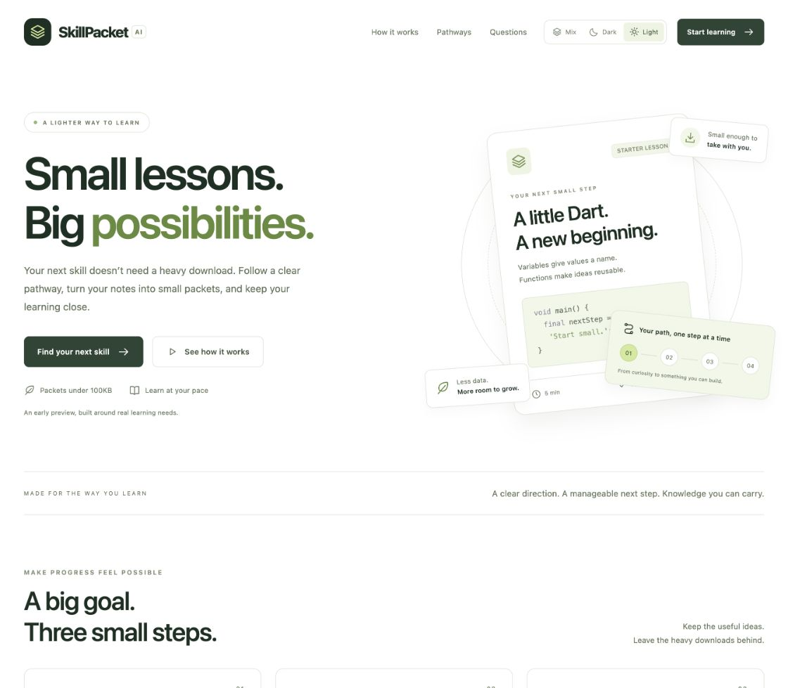

# skillpacket-ai

An offline-first learning app designed to turn educational resources into small learning packets connected to career skills. The current build is a local web PWA and TypeScript backend foundation, with four curated career pathways.

**Current status:** the core application runs, but the complete AI learning MVP is not ready for sign-off. Live AI lesson generation and PDF extraction are missing. Cold offline reopening failed in the embedded browser and needs further investigation and standard-browser/device verification.

## Start the app

### Docker Compose

Requires Docker with Compose. From this project folder:

```sh
docker compose up --build -d --wait
```

Open [SkillPacket](http://localhost:8080/) or the [learning workspace](http://localhost:8080/learn). Compose starts the backend first, waits for its health check, then starts the Nginx frontend. The frontend proxies `/api` to the internal backend; only the web port is published, on loopback. SQLite lives in the persistent `skillpacket-data` volume, separate from the existing local database.

```sh
docker compose logs -f
docker compose down
```

Stopping with `down` preserves the database. Avoid `down -v` unless you intend to erase Docker data. Optional settings are in [.env.example](.env.example); copy it to `.env` to change the web port or shared service token (at least 24 characters). The default token supports local development and stays in the server-side proxy, outside the browser bundle. See [Docker operations](docs/DEVELOPMENT.md#docker-compose) for details.

### Run with Node.js

Requires **Node.js 24+** and npm. From this project folder:

```sh
npm --prefix backend ci
npm --prefix frontend ci
node start.mjs
```

Open the [landing page](http://localhost:4173/) or go directly to the [learning workspace](http://localhost:4173/learn). The launcher builds the frontend and runs the backend on port **3101** and the production web preview on **4173**. Ctrl+C stops both services.

For development with frontend hot reload:

```sh
node start.mjs --dev
```

Open [the development app](http://localhost:5173/). The service worker is disabled in development; use the production preview for offline checks. Use one browser origin consistently: `localhost` and `127.0.0.1` have separate local storage.

## Project layout

```text
SkillPacket/
├── backend/              TypeScript API, SQLite storage, embedded worker, tests
├── frontend/             React web PWA, IndexedDB, service worker, tests
├── docs/                 Architecture, status, roadmap, development and testing
├── README.md             Project overview and documentation index
├── AGENTS.md             Instructions for coding agents
├── Agent.md              Pointer to the canonical AGENTS.md
├── adgent.md             Pointer retaining the earlier requested spelling
├── .gitignore            Generated files, local data and secrets excluded from Git
├── .dockerignore         Dependencies, local data and secrets excluded from images
├── compose.yaml          Backend/frontend containers and persistent database volume
└── start.mjs             Combined backend/frontend launcher
```

Keep `backend` and `frontend` as siblings. The frontend imports the shared packet schema and career catalog from the backend source tree.

## Product walkthrough

[Watch the 87-second captioned product demo](docs/demo/skillpacket-walkthrough.mp4), assembled from native-browser captures. It shows the three themes, career setup, a six-milestone roadmap, text-source submission, packet creation, reading, quiz feedback and the device library. See [demo notes and chapters](docs/demo/README.md) for scope.

## Screenshots

The landing page supports three themes. These screenshots are stored in the repository under `docs/evidence`.

**Mix**



**Dark**



**Light**



## What is implemented

| Area | Current behavior |
| --- | --- |
| Career pathways | Flutter Mobile Developer, Solar Inverter Technician, Frontend Web Developer, Data Analyst; six milestones each |
| Onboarding | Career, region, experience and daily study goal are stored |
| Resources | Pasted text, supplied transcripts, `.txt`, `.srt`, `.vtt`; optional attribution URL |
| Processing | Persistent generation jobs, status polling, failed jobs and restart recovery |
| Packet format | Summaries/excerpts, takeaways, example/task fields, narration text, quizzes and source references |
| Size validation | Each serialized JSON packet must be **less than 100,000 UTF-8 bytes** |
| Web experience | Landing page at `/`; dashboard, roadmap, reader, quizzes, library and settings at `/learn` |
| Themes | Mix (original), Dark and Light, with a device-saved preference |
| Local storage | Downloaded packets, current pathway, job tracking, quiz answers and study progress in IndexedDB |
| File handling | Packet JSON import/export and removal from the device |
| PWA foundation | Manifest, icons and versioned app-shell caching |
| Speech | Local English device voices when available; audible offline playback remains unverified |
| API documentation | OpenAPI 3.1 contract at `/openapi.json` on the backend |

Generated packets are **unreviewed source previews**, not AI teaching lessons. The hand-authored Dart starter lesson is also labeled unreviewed. Learner preferences do not yet personalize the curriculum, and regional hiring demand is not verified.

## What is pending

The next priorities are source-grounded AI lessons with meaningful quizzes, PDF extraction, and passing the full offline reopening acceptance test. Later work includes instructor review, personalization, regional opportunity evidence, YouTube retrieval, resource discovery, learner authentication, server progress sync, localization and deployment hardening. See the [development roadmap](docs/ROADMAP.md) for scope and acceptance criteria.

## Documentation

- [Current status: completed, partial and pending work](docs/STATUS.md)
- [Development roadmap and acceptance gates](docs/ROADMAP.md)
- [Architecture, data models and processing flows](docs/ARCHITECTURE.md)
- [Setup, configuration, maintenance and troubleshooting](docs/DEVELOPMENT.md)
- [Tests, browser checks and offline acceptance procedure](docs/TESTING.md)
- [API reference and packet contract](docs/API.md)
- [Backend README](backend/README.md)
- [Frontend README](frontend/README.md)
- [Coding-agent guidance](AGENTS.md)

## Verification

The latest feature verification passed **22 tests: 12 backend and 10 frontend**, plus TypeScript checks and a production build. Browser checks confirmed Solar pathway creation, career selection after reload, packet download, and saved quiz progress. Reading and quizzes work in an already-open app with both services stopped. Cold offline reopening is not signed off; see [Testing](docs/TESTING.md).

The 100KB budget applies to **each packet**, not the initial web app download, uploaded source text, or recorded audio. This build is local; a deployed static frontend also needs HTTPS and a same-origin API proxy. The shared backend token is not learner-level authentication.
