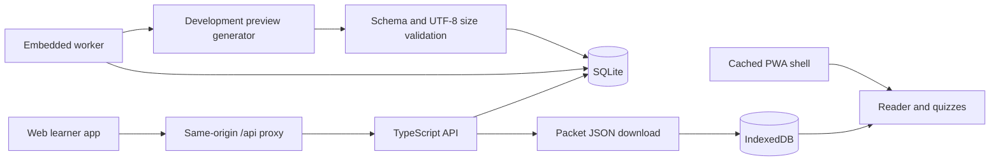

# Architecture

## Components

| Component | Implementation | Main files |
| --- | --- | --- |
| API | Node HTTP server, Zod validation | `backend/src/app.ts`, `schema.ts`, `openapi.ts` |
| Persistence | Native SQLite, WAL mode | `backend/src/store.ts` |
| Worker | One embedded worker, 250ms polling | `backend/src/server.ts`, `generator.ts` |
| Career catalog | Four curated templates | `backend/src/careers.ts` |
| Web app | React + TypeScript + Vite; landing `/`, workspace `/learn` | `frontend/src/main.tsx`, `Landing.tsx`, `styles.css` |
| Browser data | IndexedDB | `frontend/src/storage.ts` |
| Presentation preferences | Mix/Dark/Light in localStorage | `frontend/src/themes.ts`, `appearance.tsx`, initial HTML script |
| Offline shell | Versioned service worker and build-generated precache list | `frontend/public/sw.js`, `vite.config.ts` |
| Local launcher | Starts both child processes | `start.mjs` |

The frontend imports packet contracts and career definitions from its sibling backend directory. This is a shared source contract, not an independently published package. Moving the component folders independently breaks those imports.

## Server data

`entities` stores JSON bodies under `(kind, id)`, where kind is learner, roadmap, source or packet. `jobs` stores queued inputs, status, packet ID, sanitized error and timestamps. An index supports status/creation-order lookup.

- Learner: target career, region, experience, daily minutes, UUID and timestamp.
- Roadmap: learner ID, career identity, ordered nodes, `curated-template` status and `marketEvidence: null`.
- Source: text/transcript kind, submitted text, title, optional URL, English language and timestamp. Source URLs are attribution only and are never fetched.
- Job: roadmap/node/source IDs and `queued → running → succeeded | failed`.
- Packet: version, roadmap/node, objective, prerequisites, summary, takeaways, example, task, narration script, quiz, career connection, provenance, generator/review labels and timestamp.

The service claims a job, loads its resources, validates the generated packet and reference identity, then commits packet insertion and successful job status together. Failed jobs receive sanitized messages. On restart, running jobs return to queued. There is no failed-job automatic retry, request idempotency or multi-process worker lease.

Legacy roadmap records recover `targetCareer` from their learner at startup, defaulting to Flutter when unavailable. Browser contract parsing also restores Flutter identity for old cached records.

## Browser data

IndexedDB database `skillpacket`, version 1, has stores `packets`, `settings` and `progress`.

- Settings include the current profile/roadmap and tracked pending jobs.
- Quiz progress includes answers, checked status and optional study completion date.
- Creating a new pathway replaces the current session; previous packets remain in the library. There is no saved-pathway switcher yet.
- Theme uses the separate localStorage key `skillpacket-theme`; accepted values are `mix`, `dark`, `light`. Invalid/unavailable preferences default to Mix. A small initial HTML script applies the preference before the app renders.

All browser storage is origin-specific. Changing hostname, scheme or port creates a different local library. Browser removal/eviction can erase local data; packet export is a manual backup and does not export every profile/progress setting.

## Current generation behavior

`PacketGenerator` is the extension point. `DevelopmentGenerator` currently extracts the first source excerpt and selected sentences. The example is a placeholder and the quiz checks preview status. It does not call a model, assess mastery, verify relevance or produce reviewed teaching content. The Dart starter packet is a separate hand-authored sample.

## Budgets and boundaries

Packets must contain fewer than **100,000 serialized UTF-8 bytes** on both server and client. Request bodies are capped at 850,000 bytes; submitted source text is capped at 200,000 string characters. Narration is text, not an audio binary. App installation assets and source ingestion are separate bandwidth costs.

The current API token grants access to the whole service; it is not learner identity or ownership authorization. SQLite assumes a single owning process. Production hosting, multi-process workers, AI credentials, PDF/OCR, server progress sync and verified local job evidence are future work.
